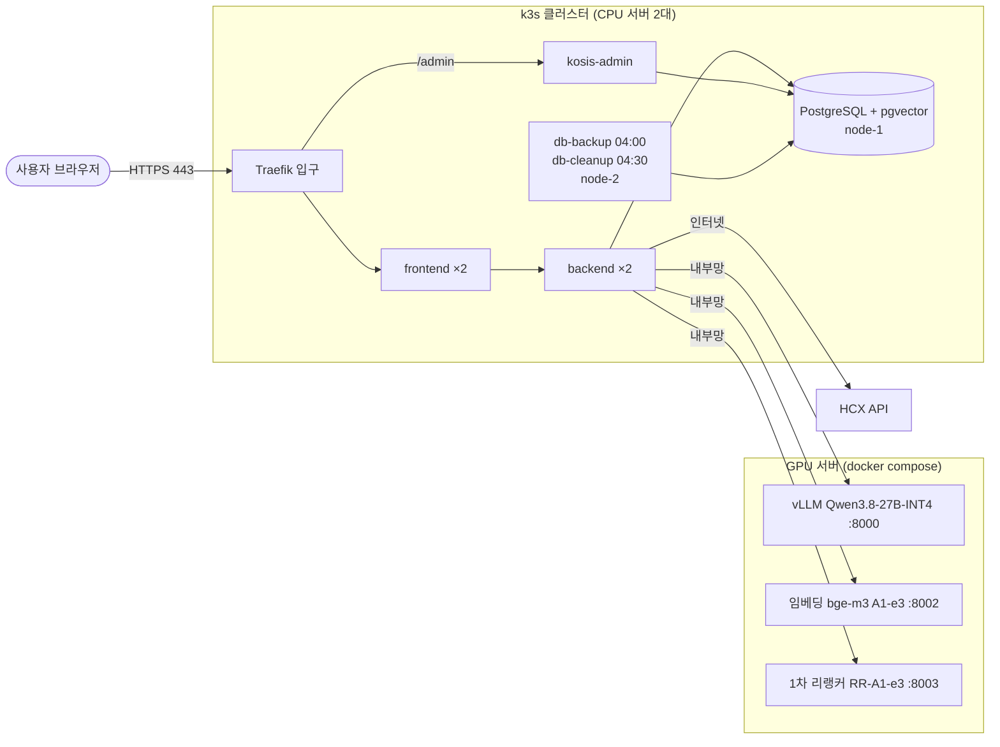

# 인프라 한눈에 보기 (2026-11-27 기준)

서비스는 학원 클라우드(AWS)에서 돈다. 서버는 3대다.
- CPU 서버 2대: k3s 클러스터로 묶어 앱과 DB를 돌린다.
- GPU 서버 1대: AI 모델(LLM·임베딩·리랭커)을 돌린다.

설정 파일은 [`deploy/`](../../deploy/README.md)에, 운영 방법은 [operations.md](operations.md)에 있다.

> 이 문서와 `deploy/`에는 서버 주소·내부 IP·키를 적지 않는다(공개 저장소).
> 실제 값은 서버의 `~/deploy/site.env`와 담당자끼리 따로 전달한 파일에만 있다.

## 서버 3대

| 이름 | 사양 | 역할 | 주요 컨테이너 |
|---|---|---|---|
| `kosis-node-1` | t3.large (2 vCPU, 8GB, 디스크 48GB) | k3s server(관리 + 작업). 고정 공인 IP(사이트 주소)를 가진 유일한 서버, SSH 입구 | postgres(pgvector), backend, frontend, Traefik(입구·HTTPS), CoreDNS |
| `kosis-node-2` | t3.large (같음) | k3s agent(작업). DB 백업 보관 | backend, frontend, kosis-admin(운영자 페이지), DB 백업·정리 예약 작업 |
| `kosis-inference` | g6e.xlarge (L40S 48GB) | AI 모델 서버. 도커 compose로 실행(k3s 밖) | vLLM(8000), 임베딩(8002), 1차 리랭커(8003) |

- backend·frontend는 2개씩 돌고, 노드마다 1개씩 놓인다.
- DB와 k3s 관리 기능은 node-1에만 있다. 운영자 페이지는 1개로 node-2에 있다(11/27 옮김). 한계는 [decisions.md](decisions.md)에 적었다.

## 무엇이 어디에

| 무엇 | 어디 | 비고 |
|---|---|---|
| 앱 이미지 | GHCR `ghcr.io/addiescode-sj/kosis-agent-{backend,frontend,migrate}:sha-<커밋>` | main merge마다 CI가 저장(T3-59). 공개라 받을 때 키가 필요 없다 |
| 운영자 페이지 이미지 | node-2 안 `kosis/admin:<태그>` | 아직 GHCR에 없어 node-1에서 빌드한 뒤 node-2로 복사한다(operations 3절) |
| k8s 설정 | node-1 `~/deploy/k8s` (+ 주소를 채운 `~/deploy/overlay`) | 저장소 `deploy/k8s`와 같은 내용 |
| 서버별 값 | node-1 `~/deploy/site.env` | 사이트 주소, GPU 내부 IP. git에 없음 |
| 배포 기록 | node-1 `~/deploy/state/deploy.log` | `60-deploy.sh`가 쓴다 |
| 제공 데이터(표·벡터 원본) | 두 노드 `/srv/kosis/data` (같은 사본) | 보안 서약: GitHub·공개 링크 금지. 서버끼리 scp로만 옮긴다 |
| DB 데이터 | node-1 local-path 볼륨 10Gi (`data-postgres-0`) | 34MB 정도 |
| DB 백업 | node-2 `/srv/kosis/backup` | 매일 04:00, 7일 보관 |
| 모델 가중치 | GPU `/srv/models/{embedder,reranker}`, 공개 모델은 `/srv/hf-cache` | 미세조정 가중치(.pt)는 GitHub 금지 |
| GPU compose | GPU `~/deploy/gpu` | 저장소 `deploy/gpu`와 같은 내용. vLLM 키는 그 폴더 `.env`(chmod 600) |
| 키 | k8s Secret `kosis-db`, `kosis-env`, `kosis-keys`, `kosis-admin` | 파일로 남기지 않는다. 넣는 법은 operations.md |

## 지금 쓰는 모델과 설정

- LLM: `RedHatAI/Qwen3.8-27B-INT4` (vLLM). 단계 판단, 이어 묻기 해석, 2차 리랭크에 쓴다.
  - `AGENT_*`를 비워 두면 `STAGE2_*` 설정을 그대로 쓴다.
  - `INTERPRETER_MODEL=stage2`다.
- 값 찾기·답변 문장: HCX(외부 API). OpenAI는 쓰지 않는다.
- 임베딩 `A1-e3.pt`와 1차 리랭커 `RR-A1-e3.pt`는 11/26 최종 가중치다.
  - 벡터 묶음은 `kosis_mixft_A1_e3`(2,364건)다.
  - 임베딩과 벡터 묶음은 **반드시 같이** 바꾼다. 다르면 검색이 거절된다.
- backend 이미지에는 torch가 없다(`WITH_EMBED=0`). 임베딩·리랭커는 `EMBED_URL`·`RERANK_URL`로 GPU 서버를 부른다.
- 저장소 [`docs/service/deploy-inference-split.md`](../service/deploy-inference-split.md)는 포트를 8001·8002로 적었다. 우리 서버는 **8002 임베딩, 8003 리랭커**다.

## 문서 지도

| 문서 | 내용 |
|---|---|
| [operations.md](operations.md) | 켜고 끄기, 점검, 배포·되돌리기, 백업·복원, 키, 가중치 교체, 정리 |
| [decisions.md](decisions.md) | 왜 이렇게 만들었나, 알려진 한계, 남은 일 |
| [history.md](history.md) | 11/23~ 배포 이력 |
| [`deploy/README.md`](../../deploy/README.md) | 설정 파일 지도, 처음 설치 순서 |
