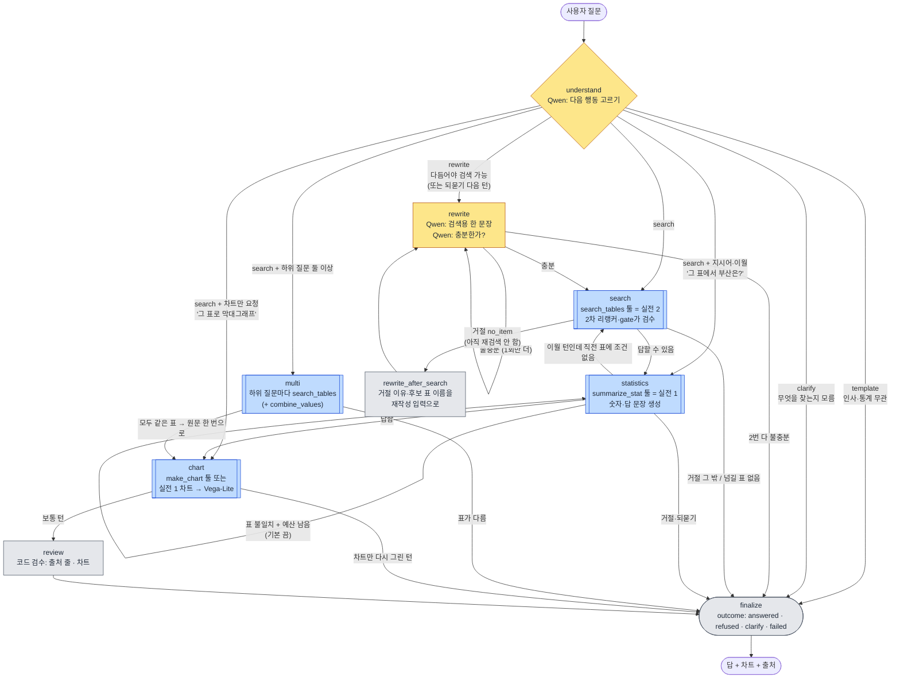
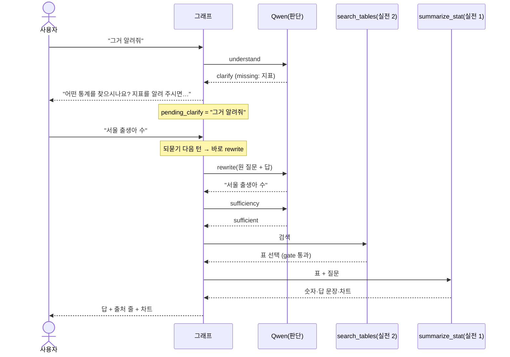

# ReAct 에이전트 아키텍처 (T3-03)

> 대상: 종합 프로젝트 팀원. 메인 그래프가 "어떤 순서로, 누가(LLM·코드·툴) 무엇을 정하는지" 한 번에 보기 위한 문서.
> 코드: [src/kosis_agent/graph/main_graph.py](../src/kosis_agent/graph/main_graph.py) · [src/kosis_agent/graph/react.py](../src/kosis_agent/graph/react.py) · 결정 기록: [plans/T3-03.md](../plans/T3-03.md)

## 1. 한 줄 요약

LangGraph `StateGraph` 하나로 돈다. 정해진 단계(이해 → 재작성 → 검색 → 답 → 차트 → 검수 → 마무리)마다
**Qwen이 Thought → Action을 한 번 고르고, 다음 노드는 그 Action 값으로 조건부 경로가 정한다.**
LLM 하나가 루프를 돌며 툴을 마음대로 부르는 구조(단일 ReAct 루프)가 아니다.

- 숫자와 답 문장은 실전 1(`summarize_stat`)이, 표 선택과 "답할 수 있는가" 검수는 실전 2(`search_tables`의 2차 리랭커·gate)가 만든다.
- Qwen은 **고르기만** 한다: 다음 행동 · 재작성 문장 · 충분한가 · 나눌까. 숫자도 답 문장도 쓰지 않는다.
- 모든 재시도는 **최대 1회**다(재작성 재시도 1 · 검색 거절 후 재검색 1).

## 2. 전체 흐름

범례: 노란색 = Qwen 판단 노드 · 파란색 = 툴 호출 노드(agent 계층 채점 대상) · 회색 = 코드만.

## 3. ReAct 다섯 요소를 이 그래프에 맞춘 방식

| 요소 | 이 그래프에서 | 누가 만드나 |
|---|---|---|
| Thought | 판단 근거 한 줄. 상태 `trace`에 단계별로 쌓임 (SSE·UI·평가 리포트에 보임) | Qwen (판단 없으면 코드가 고정 문구) |
| Action | 단계마다 코드가 정해 둔 값 중 하나. 집합 밖 값이면 그 판단을 버림 | Qwen |
| Action Input | 재작성 문장. **원문·이전 질문에 있는 낱말·숫자·시도만** 허용 (`grounded` 검사) | Qwen → 코드가 검사 |
| Observation | `search_tables`·`summarize_stat` 툴의 실제 결과 | 툴 (LLM 아님) |
| Final Answer | 실전 1 답 문장 + 출처 줄, 또는 코드 고정 문장(인사·되묻기) | 실전 1 / 코드 |

### Qwen이 고르는 Action (판단 4종, `react.Judge`)

| 판단 | 언제 | 고를 수 있는 값 | 호출 |
|---|---|---|---|
| `understand` | **매 턴 처음** (되묻기 다음 턴 제외) | `template` · `clarify` · `rewrite` · `search` | 턴당 1회 |
| `rewrite` | understand가 rewrite를 골랐거나, 되묻기 다음 턴, 또는 검색 거절(no_item) 뒤 | 검색용 한 문장 (`question`) | 최대 2회 |
| `sufficiency` | rewrite 직후 (`AGENT_STEPS=b`) | `sufficient` · `retry` (+ 빠진 슬롯: 지표·지역·기간) | rewrite마다 1회 |
| `split` | 규칙이 질문을 하위 질문 둘 이상으로 나눴을 때 (`AGENT_STEPS=b`) | `keep` · `merge` (같은 지표 비교면 합침) | 턴당 최대 1회 |

- 응답은 **JSON 한 줄**로 받아 Pydantic으로 검증한다. tool calling·structured output은 쓰지 않는다(경량 Qwen 서버에서 확인 안 됨).
- Qwen 장애·형식 오류·서버 없음 → 그 판단만 건너뛴다(`react.safe`). understand가 실패하면 **search**로 간다 = ReAct 이전과 같은 동작.

## 4. 노드별 역할

| 노드 | 하는 일 | LLM | 툴 |
|---|---|---|---|
| `understand` | 이번 턴 상태를 비우고 Qwen 판단. search·rewrite면 직전 표 재사용(지시어·이월·차트만, T3-27)과 멀티쿼리 분해(T3-28)를 확인 | Qwen 1회 (+split 1회) | — |
| `rewrite` | 검색용 한 문장으로 다시 쓰고 충분성 판단. 지어낸 숫자·지역이 있으면 버리고 원문 사용 | Qwen 2회 | — |
| `search` | 실전 2 검색 그래프 전체 실행. 새 질문은 **사용자 원문**으로, 재작성·이월 턴만 다시 쓴 문장으로 | (실전 2 내부) | `search_tables` |
| `rewrite_after_search` | 거절 이유와 가까운 후보 표 이름을 재작성 입력에 넣음 | — | — |
| `statistics` | 고른 표 하나로 실전 1 실행. 숫자·답 문장은 여기서 | (실전 1 내부 HCX) | `summarize_stat` |
| `multi` | 지표가 다른 질문을 하위 질문마다 검색·계산 | — | `search_tables` ×N, `summarize_stat` ×N, `combine_values` |
| `chart` | 차트 요청이면 `make_chart`, 아니면 실전 1 차트를 Vega-Lite로 | — | `make_chart` |
| `review` | 출처 줄(`출처: KOSIS / 조사명 / 통계표명`)이 없으면 코드가 붙임. 요청한 차트가 그려졌는지 기록 | — | — |
| `finalize` | outcome과 답 메시지 결정. 답한 표·질문·차트를 다음 턴용(`active_*`)으로 저장 | — | — |

판단 단계(understand·rewrite·review)는 일부러 **툴로 만들지 않았다.** 툴로 만들면 agent 채점이 extra_call로 감점한다.

## 5. 멀티턴: 턴 사이에 남는 상태

checkpointer(`thread_id`별)로 아래 값이 다음 턴에 이어진다.

| 상태 | 용도 |
|---|---|
| `active_table` · `active_question` · `active_chart` | "그 표에서 부산은?", "작년은?", "막대그래프로" 같은 후속 질문 |
| `pending_clarify` | 되묻기한 원 질문. 다음 턴 답과 합쳐 rewrite로 보냄 |
| `messages` | 대화 기록 |

되묻기 → 답 → 검색 예:

## 6. 안전장치 (평가 기준 "데이터 정확성 > 예외 처리" 대응)

- **LLM이 숫자를 만들지 않는다.** 재작성 문장도 원문에 없는 숫자·지역·낱말이면 버린다(`react.grounded`).
- **답할 수 없으면 툴을 더 부르지 않고 끝낸다.** 재검색은 거절 이유가 `no_item`일 때만 1회. `out_of_scope` 등은 바로 거절.
- **재시도 상한 고정:** 재작성 최대 2번(첫 시도 + 재시도 1), 검색 거절 후 재검색 1번.
- **출처 보장:** review가 실전 1 답에 출처 줄이 없으면 코드가 붙인다.
- **판단 장애 = 턴 실패가 아님:** Qwen이 죽어도 검색 경로로 계속 간다.

## 7. 설정 (환경변수)

| 변수 | 값 | 기본 |
|---|---|---|
| `AGENT_STEPS` | `off`: Qwen 판단 없음 (ReAct 이전과 같음) · `a`: 이해 + 검색 거절 후 재작성 · `b`: a + 충분성 판단 + 분해 검토 | `b` |
| `AGENT_MODEL` · `AGENT_BASE_URL` · `AGENT_API_KEY` | 판단용 Qwen (OpenAI 호환 서버) | 비우면 `STAGE2_*`(2차 리랭커와 같은 서버) |

진입점: [backend/app/config.py](../backend/app/config.py) `agent_judge()` · `agent_steps()` → [backend/app/main.py](../backend/app/main.py) `build_agent()`.

## 8. 측정 현황

| 측정 | 결과 |
|---|---|
| 오프라인 회귀 (구조 변경) | 대화 성공률·툴·파라미터·상태 지표 전·후 동일 |
| 실서버 per10 (57턴, 규칙 우선 버전 `9b4819e`) | 정확도 개선 없음 (1~2턴 차이), 지연 p95 15.2s → 23.7s |
| 실서버 (매 턴 Qwen 판단 버전) | 측정 예정 — `colab/t3_03_e2e_eval_gpu.ipynb` |

per10에서 오류는 수치·인자·상태(wrong_numbers 18 · wrong_args 7 · lost_state 7)에 몰려 있었다. 이 계층은 실전 1 계산·표 선택·지시어 해석이 정한다.
그래서 "규칙이 판단 못 한 턴에만 Qwen" 구조를 **매 턴 Qwen이 먼저 판단**하도록 바꿨다(2026-11-24). 숫자는 [plans/T3-03.md](../plans/T3-03.md) Result에 쌓는다.

## 9. 코드 지도

| 파일 | 내용 |
|---|---|
| `src/kosis_agent/graph/main_graph.py` | 노드·조건부 경로 조립 (`build_graph`) |
| `src/kosis_agent/graph/react.py` | Qwen 판단(`Judge`), 출력 계약(`UnderstandStep` 등), `grounded`, 고정 문장(`TEMPLATES`·`clarify_text`) |
| `src/kosis_agent/graph/state.py` | `AgentState` · `ChatResult` · checkpointer |
| `src/kosis_agent/graph/context.py` | 지시어·이월·차트 요청 해석 (T3-27) |
| `src/kosis_agent/graph/multiquery.py` | 멀티쿼리 분해 (T3-28) |
| `src/kosis_agent/retrieval/search.py` · `services/statistics.py` · `services/chart.py` | 툴 3종 래퍼 |
| `tests/test_react.py` | 단계 판단 오프라인 테스트 (가짜 Qwen `FakeJudge`) |
