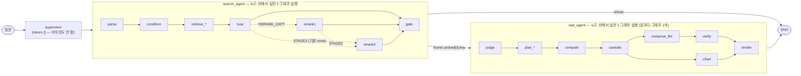

# 에이전트 그래프 구조 진단 · LangChain/LangGraph 리팩토링 추천안

- 기준: `main` @ `c57497c` (2026-11-09), 실전 1 @`907b703`, 실전 2 @`56b4252`
- 성격: T3-01 · T3-03 · T3-04 plan을 쓰기 전 참고 자료다. 승인된 plan이 아니며, 여기 적은 방향도 각 태스크의 plan-gate(옵션 → 검증 → 승인 → 측정)를 거쳐 정한다.

## 0. 요약

1. 지금 그래프는 **에이전트가 아니라 고정 파이프라인**이다. supervisor는 아무것도 하지 않고, LangChain 툴은 하나도 없으며, LLM이 다음에 무엇을 할지 고르는 곳도 없다.
2. 그래프 **중첩 방식 자체는 문제가 아니다**. 상태 스키마가 다른 그래프를 노드 함수 안에서 호출하는 것은 LangGraph가 안내하는 정상 패턴이다. 특히 실전 1 그래프는 표마다 따로 만들어지므로 고정 노드로 넣을 수도 없다.
3. 가장 급한 문제는 **이미 만든 에이전트 평가 하네스(T3-06)와 그래프의 계약이 맞지 않는 것**이다. 하네스는 `build_agent`, checkpointer, LangChain 툴 호출 span을 기대하는데, 지금 그래프에는 셋 다 없다. 그래서 툴·파라미터 정확도, 멀티턴, 토큰·비용을 잴 수 없다.
4. 추천 방향(옵션 B): 실전 1·2는 그대로 둔 채 **툴 3개로 감싸고**, 그 위에 `bind_tools` + `ToolNode` ReAct 루프와 checkpointer를 얹는다. 성능이 낮다고 측정된 단계만 나중에 바깥 그래프로 꺼낸다(옵션 C).

## 1. 현재 실행 구조



| 층 | 위치 | 호출 방식 | 상태 |
|---|---|---|---|
| 바깥 | [src/kosis_agent/graph.py](../src/kosis_agent/graph.py) | `StateGraph(AgentState)`, 엣지가 모두 고정 | `messages`, `search`, `stat` |
| 실전 2 | [graph/search.py](../vendor/phase2/src/kosis_rag/graph/search.py) | `search_agent`가 `SearchModule.stream()`을 부르고, 그 안에서 `graph.stream()` 실행 | `SearchState` |
| 실전 1 | [kosis_chat/graph/build.py](../vendor/phase1/kosis_chat/graph/build.py) | `stat_agent`가 `summarize_stat_run()`을 부르고, 그 안에서 `StatPipeline`의 그래프 실행 | `StatState` |

- LangGraph의 정식 subgraph(`add_node(name, compiled_graph)`)를 쓰지 않고 **노드 함수 안에서 따로 호출**한다. 그래서 바깥 그래프에 돌아오는 것은 최종 결과(`SearchOutput`, `StatOutput`)뿐이다. 안쪽 노드의 진행은 `get_stream_writer()`로 내보내는 이벤트로만 보인다.
- 실전 2 그래프는 시작할 때 자원을 한 번 열고 k마다 compile해서 캐시한다([api.py:86-91](../vendor/phase2/src/kosis_rag/api.py#L86-L91)). 실전 1 그래프는 **표마다** 자원을 붙잡고 만들어진다([build.py:84-88](../vendor/phase1/kosis_chat/graph/build.py#L84-L88)). 어떤 표를 쓸지는 실행 중에 정해지므로, 실전 1은 앞으로도 노드나 툴 안에서 호출하는 형태가 맞다.
- 실전 2의 2차 리랭커(`rerank2`)는 `STAGE2`가 `clova`·`hcx`·`gpt` 중 하나일 때만 그래프에 들어간다. 기본값은 `none`이다([backend/app/config.py:88](../backend/app/config.py#L88)).

## 2. 문제점 (영향이 큰 순서)

### P1. 툴 계층이 없다: 에이전트가 아니라 고정 파이프라인
- 바깥 그래프는 `supervisor → search_agent → stat_agent` 순서가 엣지로 고정돼 있다([graph.py:132](../src/kosis_agent/graph.py#L132)). supervisor는 `return {}`만 한다.
- `@tool`, `StructuredTool`, `bind_tools`, `ToolNode`이 `src/`, `backend/`, 실전 2 비레거시 코드 어디에도 없다. 유일한 예외는 [legacy/tools.py](../vendor/phase2/src/kosis_rag/legacy/tools.py)인데, 그래프 경로에서는 쓰지 않는다.
- CLAUDE.md가 정한 툴(`search_tables` · `summarize_stat` · `make_chart`)은 T3-01 미착수 상태다. "LLM이 툴 선택·순서 결정"(T3-03)도 아직 시작하지 않았다.

### P2. 에이전트 평가 하네스(T3-06)와 계약이 맞지 않는다
[evals/runners/agent.py](../evals/runners/agent.py)와 [tracing.py](../src/kosis_agent/tracing.py)가 그래프에 기대하는 것과 현재 상태는 다음과 같다.

| 하네스가 기대하는 것 | 현재 | 결과 |
|---|---|---|
| `kosis_agent.graph:build_agent()`가 compile된 그래프를 돌려줌 | `build_graph(search, stat_llm)`: 인자가 필요하고 이름도 다름 | `--agent`로 불러올 수 없음 |
| checkpointer가 `thread_id`별로 대화를 이어 줌 | `compile()`에 checkpointer 없음 | 멀티턴 시나리오가 매 턴 처음부터 시작 |
| 툴 호출이 `on_tool_start`로 잡혀 `execute_tool <name>` span이 됨 | LangChain 툴이 없음 | 툴·파라미터 정확도의 분자와 분모가 모두 0 |
| LLM 호출이 `on_chat_model_start`로 잡혀 `chat <model>` span이 됨 | 실전 1·2의 LLM은 `urllib`·`openai` SDK를 직접 호출 | `llm_calls`·토큰·비용이 0으로 기록됨 |

종합 핵심 지표(툴·파라미터 정확도, 멀티턴 성공률, 요청당 비용) 중 지금 그래프로 잴 수 있는 것은 최종 수치 정확도와 지연뿐이다.

### P3. 멀티턴이 불가능하다 (T3-04)
- 백엔드는 매 요청마다 질문 하나만 넣는다. `thread_id`가 없다([backend/app/main.py](../backend/app/main.py) `graph.stream({"messages": [("user", req.question)]})`).
- `search_agent`는 `messages[-1].content`를 그대로 검색 질문으로 쓴다([graph.py:103](../src/kosis_agent/graph.py#L103)). 그래서 "그 표에서 2020년만", "이거 막대로" 같은 지시어를 해석할 곳이 없다.
- `AgentState.search`와 `stat`은 턴마다 덮어쓴다. "지난 턴의 표"는 남지만, 대화 전체 이력이 아니라 직전 한 턴뿐이다.

### P4. 안쪽 그래프의 신호를 바깥에서 쓸 수 없다
- 리랭커가 아무 표도 고르지 않은 경우(`stage2_picked_n = 0`), 리랭커가 실패한 경우(`stage2_error`), 실전 1이 되묻기(`clarify`)로 끝난 경우를 바깥 그래프가 보고 분기할 수 없다.
- 2차 리랭커가 실패하면 예외를 삼키고 1차 순서를 그대로 쓴다([stage2.py:49](../vendor/phase2/src/kosis_rag/rerank/stage2.py#L49), [api.py:47-50](../vendor/phase2/src/kosis_rag/api.py#L47-L50)). 답에는 드러나지 않고, `rerank2` 이벤트의 `stage2_error`로만 알 수 있다.

### P5. 오류가 나면 턴 전체가 실패한다
- 실전 1의 `LookupError`(표 키가 tables.csv에 없음), `LLMKeyMissing`, `RuntimeError`(모델 호출 실패)가 그대로 전파되어 SSE `error` 이벤트로 끝난다([graph.py:93-94](../src/kosis_agent/graph.py#L93-L94)).
- `picked[1]`로 다시 시도하거나 사용자에게 되묻는 경로가 없다.

### P6. 차트가 stat_agent에 묶여 있다 (T3-02)
- 차트는 실전 1 `StatOutput.chart`(ChartSpec)를 `to_vega`로 바꾼 것뿐이다([graph.py:73](../src/kosis_agent/graph.py#L73)). 그래서 "막대로 다시 그려 줘"처럼 차트만 따로 요청할 수 없다.

### P7. (리스크, 확인 필요) checkpointer를 붙인 뒤 안쪽 그래프의 동작
- 노드 안에서 compile된 그래프를 호출하면, LangGraph는 부모의 실행 config를 물려받아 그 그래프를 subgraph처럼 다룬다. 실전 1·2 그래프는 `compile()`에 checkpointer 인자를 주지 않았으므로 부모의 checkpointer를 물려받을 수 있다.
- 그렇게 되면 `SearchState`(Document 목록)나 `StatState`까지 체크포인트에 저장하려 들 수 있다. 직렬화, 용량, 속도 문제가 생길 수 있다.
- T3-04에서 checkpointer를 붙일 때 pytest 하나로 확인한다. 문제가 있으면 툴 안에서 안쪽 그래프를 부를 때 부모 config를 끊는다.

## 3. 바꾸지 않을 것

- `vendor/phase1`, `vendor/phase2`는 직접 고치지 않는다. 필요하면 해당 레포에 PR을 낸다.
- 숫자는 실전 1의 코드(pandas)가 계산한다. 에이전트 LLM은 툴 결과의 숫자를 다시 쓰지 않고, 최종 답 문장은 `StatAnswer.text`를 그대로 쓴다.
- 표 키는 코드가 보장한다. LLM이 `table_key` 인자를 만들게 하더라도, 직전 검색 결과의 후보 안에 있는 키만 받는다. 실전 2 리랭커가 번호만 고르게 해서 키를 지어낼 수 없게 한 원칙([stage2.py:48](../vendor/phase2/src/kosis_rag/rerank/stage2.py#L48))을 바깥 그래프에서도 지킨다.
- 실전 2·1이 이미 열어 둔 확장 지점을 먼저 쓴다.
  - 실전 2: `graph_nodes()` · `add_search_edges()`([search.py:217](../vendor/phase2/src/kosis_rag/graph/search.py#L217), 다른 그래프에 검색 노드를 이어 붙이도록 만든 API), `make_nodes()`([nodes_api.py](../vendor/phase2/src/kosis_rag/graph/nodes_api.py))
  - 실전 1: `StatOptions.node_overrides`(노드 하나를 같은 시그니처 함수로 교체)

## 4. 리팩토링 옵션

| | A. 계약만 맞춤 | **B. 툴 + ReAct 루프 (추천)** | C. B + 약한 단계만 바깥으로 꺼냄 |
|---|---|---|---|
| 무엇 | 지금 순서를 유지하고, 각 단계를 LangChain 툴로 감싸 span이 나오게 함. `build_agent` 추가, checkpointer 추가 | 툴 3개 + `agent` 노드(`bind_tools`) + `ToolNode` + `tools_condition` + checkpointer | B에 더해, 실전 2 노드를 `graph_nodes`로 바깥 그래프에 직접 펼치고 `rerank2`·`gate` 신호로 분기(되묻기 등) |
| 풀리는 문제 | P2 (부분), P3 (저장만) | P1 · P2 · P3 · P5 · P6 | B + P4 |
| 실전 1·2 | 블랙박스 | 블랙박스 (툴 안) | 실전 2는 노드 단위로 꺼냄, 실전 1은 블랙박스 |
| 비용·리스크 | 작음. 하지만 툴 선택이 고정이라 툴 정확도가 항상 100%라는 의미 없는 수치가 나옴 | 중간. 에이전트 LLM 호출 1~3회가 턴마다 늘어나 지연·비용 증가. 툴을 잘못 고를 위험 | 큼. 실전 2 상태(`SearchState`)를 바깥 상태와 맞춰야 함. 실전 2 내부 변경에 끌려감 |
| 쓰임 | T3-07에서 비교할 "고정 파이프라인" 기준선 | T3-03 · T3-07 ReAct 단일 에이전트 | T3-08 Plan-and-Execute · T3-09 멀티 에이전트 후보 |

**추천: A의 고정 파이프라인을 기준선으로 남겨 두고, 구현은 B로 간다. C는 T3-07 측정에서 검색 단계가 병목으로 나올 때만 한다.**

예상 수치는 적지 않았다. 지금 그래프로는 툴 정확도·멀티턴·비용 지표를 잴 수 없어(P2) 전 수치 자체가 없기 때문이다. A로 기준선을 먼저 잰 뒤, 각 태스크 plan에서 "몇 → 몇"을 예상하고 측정한다.

### 옵션 B 스케치

새 파일 없이 `src/kosis_agent/graph.py` 하나에 둘 수 있는 크기다. 아래는 방향만 보여 주는 코드이고, 구현할 때 pytest로 검증한다.

```python
import json
from typing import Annotated

from langchain_core.messages import ToolMessage
from langchain_core.tools import InjectedToolCallId, tool
from langgraph.checkpoint.memory import InMemorySaver
from langgraph.graph import START, StateGraph
from langgraph.prebuilt import InjectedState, ToolNode, tools_condition
from langgraph.types import Command


def make_tools(search, stat_llm, summarize=summarize_stat_run):
    @tool
    def search_tables(question: str, tool_call_id: Annotated[str, InjectedToolCallId]) -> Command:
        """Find KOSIS tables that answer the question. Returns route and candidate table keys."""
        out = search.search(SearchInput(question=question))
        brief = {"route": out.route, "refusal_text": out.refusal_text,
                 "tables": [{"key": c.key, "table_name": c.table_name, "period": c.period} for c in out.picked]}
        return Command(update={"search": out, "messages": [
            ToolMessage(json.dumps(brief, ensure_ascii=False), tool_call_id=tool_call_id)]})

    @tool
    def summarize_stat(question: str, table_key: str, state: Annotated[dict, InjectedState],
                       tool_call_id: Annotated[str, InjectedToolCallId]) -> Command:
        """Answer the question from one table found by search_tables (numbers are computed by code)."""
        found = state.get("search")
        if found is None or table_key not in {c.key for c in found.candidates}:
            raise ValueError(f"unknown table_key {table_key!r}: call search_tables first")  # ToolNode -> error ToolMessage
        stat = summarize(question, table_key, llm=stat_llm)
        return Command(update={"stat": stat, "messages": [
            ToolMessage(stat.answer.model_dump_json(), tool_call_id=tool_call_id)]})

    return [search_tables, summarize_stat]  # + make_chart (T3-02)


def build_agent_graph(search, stat_llm, chat_model, *, checkpointer=None):
    tools = make_tools(search, stat_llm)
    model = chat_model.bind_tools(tools)

    def agent(state: AgentState) -> dict:
        return {"messages": [model.invoke(state["messages"])]}

    g = StateGraph(AgentState)
    g.add_node("agent", agent)
    g.add_node("tools", ToolNode(tools))  # handle_tool_errors=True by default: exceptions become ToolMessages
    g.add_edge(START, "agent")
    g.add_conditional_edges("agent", tools_condition)  # tool calls -> tools, otherwise END
    g.add_edge("tools", "agent")
    return g.compile(checkpointer=checkpointer or InMemorySaver())
```

각 부분이 앞의 문제를 이렇게 푼다.
- `ToolNode`가 툴을 실행하므로 `on_tool_start`가 불려 `execute_tool` span이 생긴다(P2). 툴에서 난 예외는 `ToolMessage`로 바뀌어 LLM이 다른 후보를 고르거나 되물을 수 있다(P5).
- `InjectedState`로 직전 검색 결과를 툴 안에서 읽어 `table_key`를 검증한다(3절 원칙). 이 인자는 LLM에게 보이는 툴 스키마에 나타나지 않는다.
- `Command(update=...)`로 `search`·`stat`을 상태에 남긴다. checkpointer가 턴 사이에 이 상태를 이어 주므로, 다음 턴의 LLM이 "그 표"를 직전 `search`의 키로 해석할 수 있다(P3).
- 에이전트 LLM은 `langchain-naver`의 `ChatClovaX`(이미 의존성에 있음)나 OpenAI 모델을 LangChain chat model로 쓴다. 그러면 `chat` span과 토큰이 잡힌다(P2).
- 최종 답 문장은 LLM이 새로 쓰게 하지 않고 `stat.answer.text`를 쓴다. `chat_result()`는 지금처럼 상태의 `search`·`stat`에서 만든다.

## 5. 진행 순서 (태스크 매핑)

| 순서 | 태스크 | 할 일 | 측정 |
|---|---|---|---|
| 1 | T3-01 | `search_tables` · `summarize_stat` 툴 래핑, `build_agent()` 진입점, checkpointer. 처음에는 옵션 A처럼 고정 순서로 둠 | 고정 파이프라인 기준선: e2e 수치 정확도, 지연, 실전 1·2 spans의 토큰 |
| 2 | T3-02 | `make_chart` 툴 분리 (ChartSpec → Vega-Lite, 차트 종류 자동 선택) | 차트 종류 정답률 |
| 3 | T3-03 | `agent` 노드 + `bind_tools` + `ToolNode` ReAct 루프 | 툴·파라미터 정확도, 1턴 시나리오 성공률 |
| 4 | T3-04 | 지시어 해석, 상태에 표·조건 유지, P7 확인 pytest | 멀티턴 성공률 (pass^k) |
| 5 | T3-07~10 | ReAct / Plan-and-Execute / 멀티 에이전트 비교. 약한 단계만 옵션 C로 꺼냄 | 같은 평가셋으로 정확도·비용·지연 표, ADR |

## 6. 먼저 확인할 것

1. `ChatClovaX`가 HCX-007 · HCX-005에서 `bind_tools`(function calling)를 지원하는지. 안 되면 에이전트 LLM만 OpenAI로 두고, 실전 1·2는 HCX를 유지한다.
2. 실전 1·2 내부 LLM 호출은 LangChain 콜백에 잡히지 않는다. 요청당 비용에 넣으려면 실전 1 `spans`와 실전 2 `stage2_input_tokens` · `stage2_output_tokens`를 합산하는 경로가 하네스에 필요하다.
3. 운영과 평가에서 쓸 `STAGE2` 값. `none`이면 2차 리랭커가 아예 돌지 않는다.
4. P7: checkpointer를 붙였을 때 안쪽 그래프 상태도 저장되는지.
