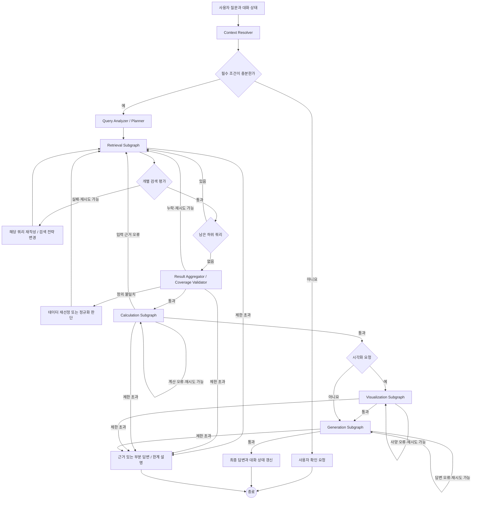

# LangGraph 기반 통계 RAG 아키텍처

## 1. 목적과 설계 결정

사용자 질문을 통계 데이터의 근거 있는 답변으로 변환한다. 질문이 이전 턴을 참조하거나 여러 지표·지역·기간을 함께 요구해도, 검색 → 계산 → 시각화 → 답변 생성의 순서를 유지한다. 각 단계는 성공 기준을 통과해야 다음 단계로 진행한다.

권장 구조는 **Context-aware Plan-and-Execute + Evaluator-Optimizer**다. 실행 계획은 제한된 스키마로 표현하고, LangGraph의 `StateGraph`와 조건부 경로로 수행한다. 검색·계산·시각화·생성은 각각 서브그래프로 분리한다. 병렬 실행은 현재 요구사항에 포함하지 않는다.

| 관심사 | 설계 결정 |
|---|---|
| 멀티턴 | Context Resolver가 생략 조건과 이전 결과 참조를 복원한다. |
| 멀티쿼리 | Planner가 하위 질문을 분해하고 순서를 정한다. 각 검색을 순차 실행한다. |
| 품질 관리 | 하위 검색별 평가, 전체 커버리지 평가, 단계별 검증을 분리한다. |
| 계산 | 검증된 원자료를 결정적 코드로 계산하고 수치·단위·정의를 검증한다. |
| 시각화 | 요청된 경우에만 데이터와 차트 사양을 생성·검증한다. |
| 종료 | 성공, 근거 있는 부분 답변, 사용자 확인 요청, 제한 초과 중 하나로 끝낸다. |

## 2. 전체 흐름



그림의 자기 루프는 개념 표현이다. 구현에서는 실행 노드와 평가·수정 노드를 구분하고 조건부 경로로 연결한다. 재시도할 때는 동일한 호출을 반복하지 않고, 평가가 기록한 실패 원인에 따라 입력이나 검색 전략을 바꾼다.

## 3. 멀티턴: Context Resolver

Context Resolver의 입력은 현재 질문, 직전 대화의 요약된 조건, 검증된 결과의 참조 정보다. 출력은 `resolved_query`와 구조화된 `active_filters`다. 현재 질문에 명시된 조건이 이전 턴에서 이어받은 조건보다 우선한다. 생략된 조건은 지표, 지역, 기간, 단위, 통계 기준, 연산, 시각화 요청을 각각 추적해 복원한다.

예를 들어 첫 질문이 “2024년 서울 인구는?”이고 다음 질문이 “부산이랑 비교해서 그래프로 보여줘”라면, 두 번째 턴은 2024년 인구라는 지표·기간을 계승하고 지역을 서울·부산으로 확장하며 비교와 시각화를 요청한 것으로 해석한다. 이전 서울 결과는 **동일 지표 정의·기간·단위·출처 버전**을 만족할 때만 재사용한다. 기준이 다르거나 오래된 결과라면 다시 검색한다.

복원 결과가 둘 이상으로 해석되고 선택에 따라 수치가 달라진다면 임의로 채우지 않는다. 예를 들어 “인구”가 주민등록인구와 인구총조사 중 무엇인지 결정할 근거가 없으면 사용자 확인 경로로 이동한다. Resolver의 평가 항목은 명시 조건 보존, 참조 대상 일치, 상속 조건의 출처, 모호성 여부다.

## 4. Query Planner와 Multi-query Retrieval

Planner는 해석된 질문을 실행 가능한 하위 작업으로 바꾼다. **Query Decomposition**은 서울·부산처럼 서로 다른 근거가 필요한 하위 질문을 만들고, **Query Expansion**은 한 하위 질문에 대한 동의어·표현 변형을 만드는 검색 전략으로만 사용한다. 두 개념을 같은 작업 수로 세지 않는다.

계획의 각 작업에는 `task_id`, 질문 목적, 지표, 지역, 기간, 요구 단위·정의, 선행 작업, 완료 기준을 넣는다. Planner 출력은 스키마로 검증하고 허용된 작업 유형과 최대 작업 수를 제한한다. 이 단계의 계획은 임의의 도구 호출 목록이 아니라 검증 가능한 데이터 요구사항이다.

```json
{
  "tasks": [
    {"task_id": "seoul", "kind": "retrieval", "metric": "population", "regions": ["Seoul"], "periods": ["2024"], "depends_on": []},
    {"task_id": "busan", "kind": "retrieval", "metric": "population", "regions": ["Busan"], "periods": ["2024"], "depends_on": []},
    {"task_id": "compare", "kind": "calculation", "metric": "population", "regions": ["Seoul", "Busan"], "periods": ["2024"], "operation": "compare", "depends_on": ["seoul", "busan"]}
  ]
}
```

Retrieval Subgraph는 `current_query_index`가 가리키는 하위 질문 하나만 처리한다. 후보 통계표와 메타데이터를 검색하고 필요하면 재정렬한 뒤, 개별 평가를 통과한 결과를 저장한다. 성공하면 인덱스를 증가시켜 다음 질문으로 이동한다. 실패하면 그 질문의 검색어·필터·검색 방식만 수정한다. 앞서 검증된 다른 질문의 결과는 유지한다.

### 검색 검증의 두 수준

| 평가 | 성공 기준 | 실패 시 경로 |
|---|---|---|
| 개별 검색 | 하위 질문의 지표·지역·기간·단위·통계표 정의가 맞고 원자료 위치와 출처를 확인할 수 있다. | 해당 질문만 재작성, 필터 조정, 후보 재정렬 또는 다른 출처 검색 |
| 전체 커버리지 | 모든 필수 하위 질문에 검증된 근거가 있다. | 누락된 질문만 검색 계획에 다시 넣는다. |
| 결과 간 정합성 | 비교 대상의 지표 정의, 집계 주기, 단위, 지리 범위, 기준 시점이 호환된다. | 정규화 규칙을 적용하거나 부적합한 결과를 재선정한다. |

검색 결과에는 최소한 통계표 ID, 출처, 원자료 참조, 수집·기준 시점, 지표 정의, 단위, 지역·기간 범위, 검증 상태를 남긴다. “서울의 주민등록인구”와 “부산의 인구총조사 인구”처럼 정의가 다르면 각 검색이 성공했어도 전체 평가는 실패한다. 변환 가능한 단위 차이는 명시적인 정규화 규칙으로 처리하고, 정의 차이를 수치 변환으로 덮지 않는다.

## 5. Calculation Subgraph

입력은 전체 평가를 통과한 결과와 계산 명세다. 원자료 참조를 통해 Parquet 등 데이터 저장소에서 필요한 행과 열을 조회하고, 타입·결측·중복·기간·단위를 확인한 뒤 결정적 계산 모듈을 실행한다. 비교, 증감률, 비율, 합계 등 연산은 허용된 함수와 명시된 분모·반올림 규칙으로 제한한다.

출력은 계산값뿐 아니라 사용한 입력값, 수식, 단위, 출처와 원자료 참조를 포함한다. 검증은 코드로 수행한다. 예를 들어 증감률의 분모가 0인지, 합계의 구성 항목이 중복됐는지, 지역·기간이 일치하는지 확인한다. 수치가 비정상적이면 계산식 문제와 원자료 문제를 구분한다. 후자면 Retrieval로 되돌아가 해당 데이터만 교체한다.

## 6. Visualization Subgraph

`requires_visualization`이 참일 때만 실행한다. 계산 결과의 형태에 맞춰 차트 사양을 만들고, 사용 가능한 데이터 열에만 축·범례·라벨을 매핑한다. 비교는 막대그래프, 시간 변화는 선그래프처럼 기본 규칙을 두되, 사용자 요청이 있으면 이를 우선한다.

검증 항목은 차트 데이터와 계산값의 일치, 축과 단위의 정확성, 누락값 표시, 범례의 의미, 과도한 절단축 여부다. 검증 실패는 사양 또는 데이터 매핑을 수정해 이 단계에서 재시도한다. 원자료 결함이 드러나면 Calculation 또는 Retrieval로 되돌린다. 차트를 생성할 수 없더라도 검증된 수치가 있다면 한계를 알리고 표나 텍스트로 답할 수 있다.

## 7. Generation Subgraph

입력은 검증된 검색 근거, 계산 결과, 시각화 결과와 사용자 질문이다. 답변에는 수치, 단위, 기준 시점, 통계 정의, 출처를 연결하고 비교·해석은 확보된 근거 범위 안에서만 작성한다. 답변 평가에서는 모든 핵심 수치가 계산 결과와 일치하는지, 출처가 정확히 대응하는지, 필수 하위 질문의 답이 빠지지 않았는지 확인한다.

답변의 문장 문제는 Generation에서 재작성한다. 근거 누락은 Retrieval, 계산값 오류는 Calculation으로 되돌린다. 검증되지 않은 수치를 답변 문장에 직접 생성하지 않는다. 필요한 데이터를 찾지 못했다면 확인된 사실과 확인하지 못한 범위를 구분해 설명한다.

## 8. State와 checkpoint

대화 상태와 현재 실행 상태를 구분한다. 대화 상태에는 이어받을 조건과 재사용 가능한 **검증된 결과 참조**를 저장하고, 실행 상태에는 이번 턴의 계획, 각 단계 산출물, 평가와 재시도 정보를 저장한다. 큰 원자료 전체를 `messages`나 checkpoint에 계속 복사하지 않고 저장소 키·표 ID·버전과 필요한 요약만 기록한다.

다음은 설계용 TypedDict 예시다. 모든 식별자와 코드는 영문이며, 실제 구현에서는 입력·출력 검증을 별도의 스키마로 강화한다.

```python
from typing import Annotated, Any, Literal, NotRequired, TypedDict

from langchain_core.messages import AnyMessage
from langgraph.graph.message import add_messages


class Filters(TypedDict, total=False):
    metric: str
    regions: list[str]
    periods: list[str]
    unit: str
    statistical_definition: str
    operation: str


class QueryTask(TypedDict):
    task_id: str
    kind: Literal["retrieval", "calculation"]
    metric: str
    regions: list[str]
    periods: list[str]
    depends_on: list[str]
    operation: NotRequired[str]


class Evidence(TypedDict):
    task_id: str
    source_id: str
    table_id: str
    data_ref: str
    source_version: str
    metric_definition: str
    unit: str
    periods: list[str]
    regions: list[str]
    validated: bool


class Evaluation(TypedDict):
    passed: bool
    reason_codes: list[str]
    details: str


class RAGState(TypedDict):
    messages: Annotated[list[AnyMessage], add_messages]
    current_query: str
    resolved_query: str
    active_filters: Filters
    conversation_context: dict[str, Any]
    referenced_results: list[Evidence]
    query_plan: list[QueryTask]
    current_query_index: int
    retrieval_results: dict[str, Evidence]
    retrieval_evaluations: dict[str, Evaluation]
    coverage_evaluation: NotRequired[Evaluation]
    calculation_results: NotRequired[dict[str, Any]]
    calculation_evaluation: NotRequired[Evaluation]
    requires_visualization: bool
    visualization_spec: NotRequired[dict[str, Any]]
    visualization_evaluation: NotRequired[Evaluation]
    final_answer: NotRequired[str]
    answer_evaluation: NotRequired[Evaluation]
    retry_counts: dict[str, int]
    errors: list[str]
    outcome: NotRequired[Literal["success", "partial", "clarification", "failed"]]
```

`messages`에는 `add_messages` reducer를 적용한다. `retrieval_results`와 `retry_counts` 같은 사전 필드는 각 노드가 갱신된 **전체 사전 값**을 반환하거나 별도 reducer를 정의해 업데이트 손실을 막는다. 체크포인터를 연결하고 같은 대화에 같은 `thread_id`를 사용하면 턴 사이에 상태를 복원할 수 있다. 운영 환경에서는 영속 checkpoint 저장소를 사용하고, 보존 기간과 개인정보 처리 정책을 정한다. 여러 대화 사이에서 공유할 장기 정보가 필요하면 checkpoint와 별도 저장소를 구분한다.

## 9. 조건부 경로와 종료 조건

각 평가 노드는 `passed`, `reason_codes`, 재시도 가능 여부를 반환한다. 경로 선택은 가능한 한 코드 기반 조건으로 결정한다. 재시도 예산은 전체 실행과 단계별·하위 질문별로 따로 둔다. 예시 기본값은 하위 검색 3회, 전체 계획 보완 2회, 계산·시각화·생성 각 2회이며 운영 지표로 조정한다. 같은 실패 사유가 반복되면 전략 변경 없이 재시도하지 않는다.

| 결과 | 종료 조건 | 사용자에게 전달할 내용 |
|---|---|---|
| 성공 | 필수 하위 질문, 계산, 요청된 차트, 답변 평가가 모두 통과 | 검증된 답변과 근거 |
| 부분 답변 | 일부 근거만 확보했고 그 범위를 명확히 구분할 수 있음 | 확인된 결과, 빠진 범위와 이유 |
| 확인 요청 | 지표 정의·기간 등 핵심 조건이 모호하여 결과가 달라짐 | 결정이 필요한 최소 질문 |
| 실패 | 재시도 한도, 접근 불가, 검증 불가 또는 실행 오류 | 실패 단계와 재시도에 필요한 조건 |

추가로 총 실행 시간, 검색 비용, 계획 작업 수, 그래프 반복 횟수의 상한을 둔다. 네트워크 일시 오류의 기술적 재시도와 평가 실패에 따른 **의미적 재시도**는 분리한다. 전자는 동일 호출을 짧게 재실행할 수 있지만, 후자는 실패 원인에 맞춰 쿼리·후보·사양을 변경해야 한다.

## 10. Supervisor가 필요하지 않은 이유

현재 작업의 주 경로는 이미 정해져 있고, 단계별 성공 기준과 되돌아갈 경로도 명시할 수 있다. 최상위 Supervisor가 매 단계에서 다음 담당자를 자유롭게 선택하면 경로의 예측 가능성과 오류 추적이 어려워지고 호출 비용이 늘어난다. **Planner**는 시작할 때 작업을 구조화하고, **조건부 경로**는 검증 결과에 따라 제한된 다음 노드를 고른다. 이 둘만으로 현재 요구사항을 충족한다.

향후 통계 RAG, 일반 문서 검색, 보고서 생성처럼 서로 다른 워크플로우를 질문별로 선택해야 한다면 상위 Router를 검토한다. 여러 전문 작업자가 실행 중 지속적으로 역할을 나누고 재계획해야 할 때 Supervisor가 의미를 가진다. 지금의 서브그래프 구분은 품질 검증과 코드 경계이며, 각 단계를 자율형 에이전트로 만들 필요는 없다.

## 11. 구현 로드맵

1. **데이터 계약 수립:** 통계표 메타데이터, 원자료 참조, 지표 정의·단위·기간·지역, 출처 버전의 스키마를 정한다. 최소한 두 지역 비교 사례와 정의 불일치 사례를 준비한다.
2. **단일 질문 검색 구축:** Retrieval Subgraph와 개별 평가·재시도 경로를 만든다. 적합 통계표 검색률, 잘못된 근거 채택률, 재시도 횟수, 지연 시간을 측정한다.
3. **멀티쿼리 추가:** Planner, 순차 처리 인덱스, 전체 커버리지·정합성 검증을 넣는다. 누락 검색만 재실행되는지 확인한다.
4. **멀티턴 추가:** Context Resolver와 checkpoint를 연결한다. 생략 조건 계승, 사용자 조건 우선, 이전 결과 재사용의 유효성 검사를 확인한다.
5. **계산 연결:** Parquet 조회와 결정적 계산 함수를 연결하고, 정의·단위·분모·결측 검사를 구현한다. 원자료 오류의 검색 복귀 경로를 만든다.
6. **시각화와 답변 연결:** 조건부 차트 생성, 차트 검증, 근거 기반 답변 평가를 추가한다. 시각화가 없는 질문도 끝까지 실행한다.
7. **운영 기준 확정:** 단계별·전체 재시도 예산, 제한 시간, 부분 답변 정책, checkpoint 보존 정책을 정하고 단계별 실패 사유와 비용을 관측한다.

## 참고 문서

- [LangGraph Graph API: 상태, 노드, 경로](https://docs.langchain.com/oss/python/langgraph/graph-api)
- [LangGraph Persistence: checkpoint와 store](https://docs.langchain.com/oss/python/langgraph/persistence)
- [LangGraph Subgraphs: 부모 그래프와 서브그래프 연결](https://docs.langchain.com/oss/python/langgraph/use-subgraphs)
